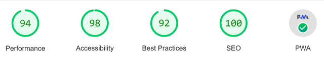
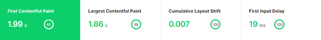

[
](https://shairaambrosio.com)

<h4 align="center">My website, shairaambrosio.com</h4>

## An overview of the project.

Hello, and welcome to my personal blog and portfolio website! My name is Shaira, and I am a Frontend Developer.

This website was created using Next.js, a popular React framework that allows for server-side rendering and automatic code splitting, resulting in lightning-fast load times and improved SEO.

Through this website, I aim to showcase my skills and experience as a developer, as well as provide a platform for sharing my thoughts and insights on the latest trends and technologies in the frontend development world.

## Development environment

| Tech                                                      | Description                                                         |
| --------------------------------------------------------- | ------------------------------------------------------------------- |
| [TypeScript](https://www.typescriptlang.org/)             | Static type-checking programming language                           |
| [Next.js](https://nextjs.org/)                            | The React Framework for Production                                  |
| [React](https://reactjs.org/)                             | Library for building user interfaces                                |
| [MDX](https://mdxjs.com/)                                 | Markdown for the component era                                      |
| [Algolia](https://www.algolia.com/)                       | Implementing search                                                 |
| [Framer Motion](https://www.framer.com/motion/)           | Motion library for React                                            |
| [Context API](https://reactjs.org/docs/context.html)      | React structure that enables to share data with multiple components |
| [TanStack Query](https://tanstack.com/query)              | Performant and powerful data synchronization for React              |
| [React Hook Form](https://react-hook-form.com)            | Forms with easy-to-use validation                                   |
| [SCSS](https://sass-lang.com)                             | CSS with superpowers                                                |
| [CSS Modules](https://github.com/css-modules/css-modules) | Styles convention in React                                          |
| [Husky](https://github.com/typicode/husky)                | Git hooks                                                           |
| [ESLint](https://eslint.org/)                             | TypeScript linting                                                  |
| [Prettier](https://prettier.io/)                          | Code formatter                                                      |
| [React-Lottie](https://lottiereact.com/)                  | Bundle vector animations                                            |
| [Date-Fns](https://date-fns.org/)                         | toolset for manipulating JavaScript dates in a browser              |

## Web performance





## Installation process

```bash
git clone https://github.com/lyella/shairaambrosio.com.git

yarn install

# set up environment variables (see .env-sample)

yarn dev

```

`yarn install` runs a `postinstall` step that patches `@types/mdx` for React 19
(upstream types still reference the removed global `JSX` namespace).

## Scripts

| Script            | What it does                                                   |
| ----------------- | -------------------------------------------------------------- |
| `yarn dev`        | Next dev server (webpack)                                      |
| `yarn build`      | Newest-post redirect + feed + sitemap + production build       |
| `yarn tsc`        | Type-check                                                     |
| `yarn lint`       | ESLint (flat config)                                           |
| `yarn test`       | vitest                                                         |
| `yarn audit:gate` | Security gate: 0 critical/high in production dependencies      |
| `yarn feed`       | Regenerate `public/feed.xml` + `feed.json`                     |
| `yarn sitemap`    | Regenerate `public/sitemap.xml` + `robots.txt`                 |
| `yarn algolia`    | Replace the Algolia `posts`/`projects` indexes from `content/` |
| `yarn format`     | Prettier write                                                 |

## Verification

`node scripts/verify-build.mjs` (after a build) asserts that:

- canonical URLs use `https://shairaambrosio.com` and never a `*.vercel.app` host
- `og:locale` is a valid `language_COUNTRY` code
- every page has a non-empty, branded `<title>`
- every JSON-LD block parses and each page has exactly one `<h1>`
- `sitemap.xml`, `robots.txt` and `feed.xml` contain no preview URLs
- no `.ttf` fonts are shipped and no removed font is preloaded

`node scripts/format-baseline.mjs` reports which files Prettier would change and
classifies each as a line-ending, trailing-newline, or substantive difference.

CI (`.github/workflows/ci.yml`) runs `yarn tsc`, `yarn lint`, `yarn format:check`,
`yarn test`, `yarn audit:gate`, the generators (with a guard against placeholder
redirects) and a production build on every push/PR to `main`.

## Engineering docs

- `plan.md` — living backlog and verification checklist
- `docs/adr/` — architecture decision records (security hardening, dependency
  migrations, security headers, design tokens, rate limiting, React 19 + tooling)
- `docs/qa-security-ux-audit-2026-11-18.md` — full audit artifact

To enable global API rate limiting on Vercel, create a KV store and set
`KV_REST_API_URL` / `KV_REST_API_TOKEN` (see `.env-sample`); otherwise the API
falls back to a per-instance in-memory limiter.

## Live Site

https://shairaambrosio.com
